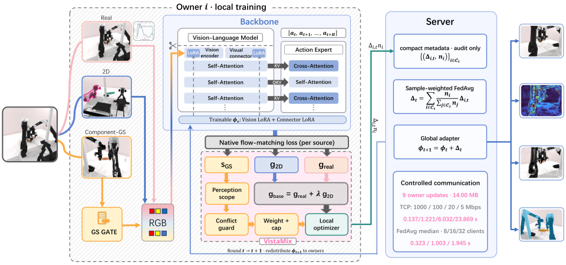

<div align="center">

# FedVista

### Robust Federated VLA Learning from Diverse Visual Worlds

[](https://github.com/Anonymous-for-Sub/FedWorldMix/actions/workflows/checks.yml)
[](LICENSE)
[](code/pyproject.toml)
[](https://anonymous-for-sub.github.io/FedWorldMix/)

[**Paper**](https://anonymous-for-sub.github.io/FedWorldMix/assets/papers/FedVista.pdf) · [**Supplement**](https://anonymous-for-sub.github.io/FedWorldMix/assets/papers/FedVista_supplement.pdf) · [**Animated paper overview & PiPER video**](https://anonymous-for-sub.github.io/FedWorldMix/#method)

</div>

FedVista adapts vision–language–action policies across clients with different visual conditions and local data sources. **VistaMix** forms a reference update from real observations and 2D augmentations, then incorporates valid Gaussian Splatting supervision through perception restriction, conflict projection and norm capping. Clients transmit LoRA updates for sample-weighted FedAvg.

[](https://anonymous-for-sub.github.io/FedWorldMix/#method)

## Results

LIBERO-10, with **1,800 OOD and 600 canonical episodes per method**:

| Method | Pooled OOD (%) | Canonical (%) |
|---|---:|---:|
| Frozen | 36.11 | 70.17 |
| FedAvg–Real | 41.33 | 77.83 |
| FedAvg–2D | 42.22 | **78.50** |
| FedAvg–GS | 40.56 | 78.00 |
| FedAvg–NaiveJoint | 42.72 | 77.17 |
| **FedAvg–VistaMix** | **46.00** | 78.17 |

VistaMix improves pooled OOD success over the equal-budget NaiveJoint control by **3.28 percentage points** (95% CI **[1.06, 5.50]**). See the paper for paired statistics, client-level evaluations and the separate OpenVLA-OFT and HPT protocols.

## Quick start

From the repository root:

```bash
git clone https://github.com/Anonymous-for-Sub/FedWorldMix.git
cd FedWorldMix
python3 -m venv .venv
source .venv/bin/activate
python -m pip install -e 'code/.[test]'
python -m pytest code/tests -q
```

The core tests run on CPU without model checkpoints or robot datasets. A direct call to the existing mixing implementation:

```python
from fedsplat.vistamix import combine_vistamix_gradients

update = combine_vistamix_gradients(
    real_gradient=[1.0, 0.0],
    two_d_gradient=[0.0, 1.0],
    gs_gradient=[-2.0, 1.0],
    gs_quality_score=0.8,
    max_gs_to_base_norm=1.0,
    projection_cosine_threshold=-0.02,
)
print(update.combined_gradient)  # (0.76, 1.07)
```

## Training and evaluation

See [code/README.md](code/README.md) for data paths, backbone environments and entrypoints. Checkpoints, aligned trajectory datasets and reconstruction assets are supplied separately.

| Configuration directory | Contents |
|---|---|
| `code/configs/libero10/` | 450 local-training configurations: 10 tasks × 3 clients × 3 training repetitions × 5 methods. |
| `code/configs/ablations/` | 126 matched sibling configurations for the safeguard comparisons. |
| `code/configs/{vistamix,real,real_2d,real_gs}/` | 36 additional client examples across tasks 3, 5 and 9. |
| `code/configs/hpt/` | HPT base configuration for the MetaWorld evaluation. |

Paths in the configurations are relative to `code/`. After preparing the assets described in the code guide:

```bash
cd code
python tools/run_smolvla_local_update.py \
  --config configs/libero10/vistamix/trainrep0/owner_00_task0.json \
  --out-dir outputs/task0_owner00_rep0
```

`fedsplat` remains the import package. Legacy `safemix` API names and serialized schemas are retained for compatibility; **FedVista** and **VistaMix** are the current paper names.

## Repository map

```text
code/
  fedsplat/          VistaMix, local VLA updates, visual sources and aggregation
  phaseb/            HPT backbone integration
  configs/           Client and backbone configurations
  tests/             CPU tests for mixing, aggregation and statistics
  hpt_tests/         HPT tensor tests (requires PyTorch)
  tools/             Training and rollout entrypoints
docs/                Static project website, native paper figures and the PiPER video
scripts/             Website integrity checks
```

Preview the website with `python -m http.server 8000 --directory docs`. GitHub Pages serves `main:/docs`. The [Checks workflow](.github/workflows/checks.yml) runs the core tests on Python 3.10 and 3.12 and validates local website links, media dimensions and JavaScript syntax.

## Citation

```bibtex
@misc{fedvista2026,
  title  = {FedVista: Robust Federated VLA Learning from Diverse Visual Worlds},
  author = {Anonymous Authors},
  year   = {2026}
}
```

Machine-readable software citation metadata is available in [CITATION.cff](CITATION.cff).

## License and acknowledgments

Original software, configurations and documentation are released under [Apache-2.0](LICENSE). See [NOTICE](NOTICE) and [third-party attribution](code/THIRD_PARTY.md) for HPT and website credits. Paper PDFs and recorded research media are described separately in the [asset notice](docs/assets/README.md).

The website layout originated from [Long-WAM](https://nvlabs.github.io/LongLive/Long-WAM/). The method uses the cited VLA backbones, federated-learning methods and robot benchmarks described in the paper. [Contribution instructions](CONTRIBUTING.md) cover bug reports and local checks.
